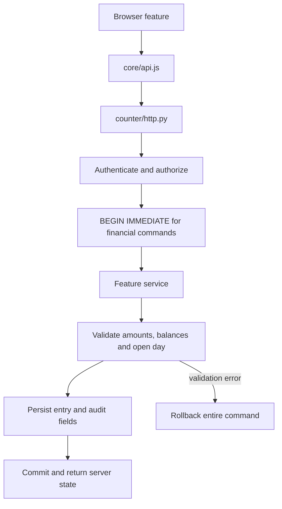
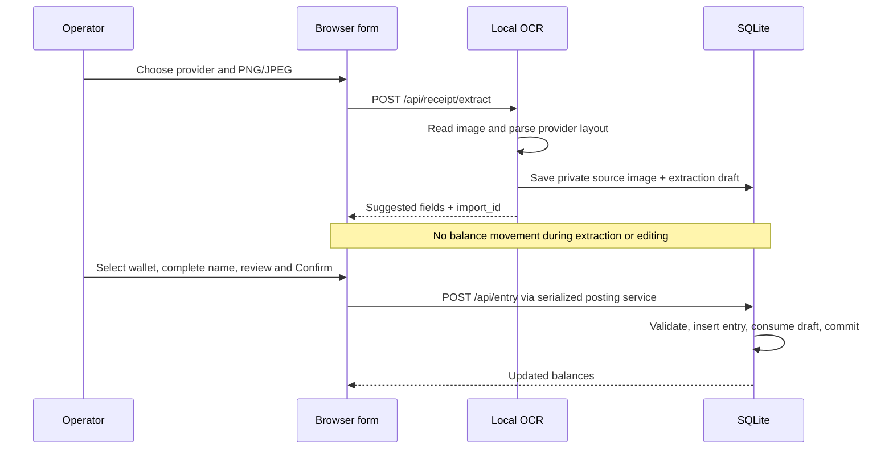

# Counter developer guide

Counter is a shared agent-shop ledger. Python serves a SQLite-backed REST API and native browser JavaScript modules. There is no frontend build step, Spring Boot service or React runtime in this version.

Start with [README.md](README.md) for operating instructions and [docs/OCR.md](docs/OCR.md) for verified receipt layouts. This guide maps the implementation and explains where to change each feature.

## 1. Local setup and verification

From the project root:

```sh
python3 -B server.py
```

Open http://127.0.0.1:8000. First visit creates the owner; there are no default credentials. The default database is `ledger.sqlite3` beside `server.py`.

For isolated development, select another database before starting:

```sh
LEDGER_DB=/tmp/counter-development.sqlite3 PORT=8010 python3 -B server.py
```

The supported setup uses Python 3.12+ with no third-party Python runtime packages. Local receipt extraction requires macOS, Apple's Swift command-line tools and Vision. The optional Myanmar-name fallback additionally needs Node.js and its local OCR dependencies:

```sh
npm ci --prefix tools/ocr
```

The browser can run on a shop computer, Mac, phone or tablet; OCR executes on the Mac server. `HOST=0.0.0.0` enables access from a trusted local network. Internet deployment needs HTTPS and a production server arrangement.

Run the complete automated suite:

```sh
python3 -B -m unittest discover -s tests -t . -v
```

Tests use temporary databases and fictional records. Never use the live shop database for test postings. Database changes should be preceded by a SQLite backup made with `Connection.backup()`.

### Money-input browser regression

Money fields share `components/money-input.js`. It blocks nonnumeric typing/paste, accepts English/Myanmar digits and comma grouping, and restores the previous accepted value if a browser applies an invalid edit. It rejects the whole invalid edit: `1e6` must never become `16`, or `100.50` become `10050`. Numeric range and whole-MMK checks remain authoritative on the server.

The optional browser check requires Node.js 20+, Google Chrome and development-only Playwright dependencies:

```sh
npm ci --prefix tools/browser
LEDGER_DB=/tmp/counter-money-check.sqlite3 PORT=8011 python3 -B server.py
```

In another terminal, after choosing a new/empty test database:

```sh
COUNTER_TEST_URL=http://127.0.0.1:8011 npm run test:money --prefix tools/browser
```

The check refuses an initialized ledger, creates a fictional owner and verifies amount/fee/commission/provider-fee/opening/count fields, invalid typing/paste, Myanmar digits, grouping, deletion, unchanged balances during editing and valid submission. Delete the temporary test database before another run, or select a new temporary filename. These dependencies are not required to run Counter.

## 2. Project structure

```text
Developer.md                         Canonical developer guide
README.md                            Operator setup and feature overview
server.py                            Startup only
receipts.py                          Compatibility imports for receipt scripts
counter/                             Python backend
  config.py                          Project/public asset paths
  schema.sql                         Base tables
  database.py                        Connections and additive startup migrations
  clock.py                           Asia/Yangon business dates
  http.py                            HTTP routes and serialized write boundary
  auth.py                            Login, sessions, passwords and owner guard
  team.py                            Owner-managed staff creation
  accounts.py                        Wallet configuration, funding and archival
  fees.py                            Whole-MMK validation and agent cash/fee rules
  ledger.py                          Validate → calculate → check → save workflow
  reversals.py                       Exact compensating postings
  queries.py                         Shared state and actual balance read model
  reports.py                         Date/account daily summaries
  closing.py                         Matching reconciliation and daily write lock
  receipts/
    reader.py                        Image validation and local OCR orchestration
    receipt_reader.swift             Apple Vision text/QR extraction
    parser.py                        Generic/KBZ fields and WavePay dispatch
    contacts.py                      Adjacent customer/contact recognition
    wavepay.py                       Wave layout dispatch and normal transfer fields
    wave_channel.py                  Channel principal/commission/net interpretation
    myanmar.py                       Optional local Myanmar name fallback
    drafts.py                        Private draft storage and expiration policy
    posting.py                       Draft review and provider-adjustment validation
    tessdata/                        Local Myanmar model and license
public/                              Browser frontend, served directly
  index.html                         Application document
  app.js                             Startup and compatibility button-handler bridge
  i18n.js                            In-place English/Myanmar language switching
  style.css                          Stylesheet imports
  css/                               Base, layout, components and responsive rules
  js/
    core/{api,store,format}.js        HTTP client, shared state and display helpers
    components/                      Forms, money inputs, cards, tables, notifications
    i18n/{messages,icons}.js          Translation keys and common SVG icons
    shell.js                         Navigation, URL hash and snapshot refresh
    features/
      transactions.js                Form opening, customer suggestions and submit
      transaction-form/
        template.js                  Field markup; stable form/API names
        receipt-review.js            Draft population, eligible wallets, image cleanup
        preview.js                   Suggested fee and displayed cash/wallet effects
      receipts.js                    Upload image and request an unposted draft
      reports.js                     Summary filters, shared columns and closing CSV
      auth.js                        Owner/staff sign-in
      overview.js                    Cash, wallet, fee and commission dashboard
      history.js                     Search/filter posted records
      accounts.js                    Wallet view and owner-only editing
      expenses.js                    Expense records
      team.js                        Owner-managed staff form
      closing.js                     Count balances and close the day
  # No financial records are stored in browser storage.
tests/                               Temporary-database regression suite
  support.py                         HTTP fixture and fictional opening funds
  test_ledger.py                     End-to-end ledger/role regression
  test_accounting.py                 Fee boundaries, balance rules, races, reversals
  test_receipts.py                   Parsing, private drafts and reviewed imports
  test_wavepay_ocr.py                 Normal WavePay Send/Receive receipts
  test_wave_channel.py               Channel commission/net, names, reports, closing
  test_myanmar_ocr.py                 Local Myanmar-name fallback
  test_wallet_permissions.py         Owner/staff account permissions
  test_daily_reports.py              Date/account summaries and closing balances
tools/ocr/                           Local Tesseract.js wrapper and locked dependencies
tools/browser/                       Optional Playwright money-input regression
docs/OCR.md                          Receipt parsing evidence and extension rules
docs/DEVELOPMENT.md                   Compatibility link to this guide
```

## 3. Request and transaction boundaries



`Handler.write_command()` owns the write transaction. Feature services receive `(connection, user, data)` and never commit independently. A balance check, entry insertion and receipt consumption therefore succeed or fail together. Keep this boundary when adding features.

`get_shop_state()` is a read model, not an accounting engine. Balances are derived from stored deltas. Browser previews are advisory; the backend validates every command.

## 4. Manual transaction flow

1. `transactions.entryForm(entryType)` selects available wallets/customer suggestions and opens the form.
2. `template.renderTransactionFields()` renders the fields. Cash In/Out require Customer Name; phone and provider transaction ID remain optional.
3. `preview.bindTransactionPreview()` attaches fee/movement listeners. Input changes do not call the posting API.
4. Confirm invokes `prepareEntryCommand()` to trim the name, normalize amounts, attach the stable command ID and confirm any separately collected cash fee.
5. `POST /api/entry` reaches `ledger.post_entry()` under the write lock.
6. The service validates the day/type/name/role/account/reference, calculates effects, checks cash and selected-wallet balances, and creates one complete record.
7. `_save_entry()` inserts named SQL parameters and consumes an import draft if present. The HTTP layer commits and returns a fresh snapshot.

`entryForm()` and `reverseEntry()` retain their public names because `app.js` exposes them for existing buttons. Internal variables use descriptive names such as `receiptDraft`, `principal`, `walletDelta` and `customerSuggestions`. Form names and REST keys retain the established wire contract.

## 5. Receipt import flow



`reader.extract_image(encoded, provider)` validates a PNG/JPEG up to 5 MB and returns `(image_bytes, extracted_fields)`. OCR runs outside the ledger write lock; the HTTP layer rechecks the session before storing a draft.

`parser.parse_receipt()` handles generic/KBZ extraction and dispatches WavePay-specific layouts to `wavepay.wavepay_fields()`. Normal transfer and Channel parsing are separate modules. Keep layout rules provider-specific; an unreadable field must remain editable rather than fabricated.

`drafts.save_draft()` stores the image/extraction and cleans expired unused drafts. `DRAFT_LIFETIME_SECONDS` is the shared 24-hour policy for storage and posting validation. Confirmed draft evidence remains linked to its entry.

`posting.load_reviewed_draft()` validates the draft owner, expiry, unused status, explicit confirmation and provider/account kind. `masked_phone_from_draft()` reads the stored extraction rather than trusting a read-only browser field.

Channel import requires a WavePay account with kind `Channel`. The operator always chooses the wallet. A negative shop-wallet receipt suggests Cash In; positive suggests Cash Out. Ambiguous direction stays selectable for review. If no customer name appears, the operator must enter one before saving.

## 6. Accounting rules and terminology

Every amount is a whole-MMK integer. These terms must remain distinct:

| Name | Meaning | Storage |
|---|---|---|
| Principal | Customer's transaction amount | `entries.amount` |
| Suggested fee | Fee policy result | `suggested_fee` |
| Collected shop fee | Actual customer fee, editable | `collected_fee`, `fee` |
| Provider commission | Wallet income from provider | `provider_commission` |
| Provider fee | Wallet expense charged by provider | `provider_fee` |
| Actual cash/wallet movement | Confirmed balance effects | `cash_delta`, `wallet_delta` |
| Receipt wallet movement | Original imported evidence; may differ from principal | Stored draft extraction |

| Agent transaction | Shop cash delta | Wallet delta before provider adjustments |
|---|---:|---:|
| Cash In | principal + collected shop fee | −principal |
| Cash Out | collected shop fee − principal | +principal |

Channel wallet delta adds `provider_commission − provider_fee`. Provider adjustments never change customer principal, collected shop fee or shop cash. For a new Cash In/Out posting, `cash_delta + wallet_delta = collected_fee + provider_commission − provider_fee`.

Example: Cash In principal 30,000, collected shop fee 100, commission 9 and provider fee 0 gives cash +30,100 and wallet −29,991. Income is shop fee 100 plus commission 9. Do not post 29,991 as customer principal.

`fees.calculate_fee()` is the authoritative suggestion. `fees.prepare_posting_amounts()` returns immutable `PostingAmounts`. `receipts.posting.validate_provider_adjustments()` returns immutable `ProviderAdjustments`; its wallet delta is applied before balance validation. Only a reviewed Channel draft authorizes nonzero provider adjustments.

Customer Name is trimmed, required for Cash In/Out, limited to 100 characters and rejects control characters. Funding/expense records require their reason/category rather than a customer name. A fee override reason is optional. Do not infer a full phone from a masked number.

## 7. Reversals, reports and daily closing

- `reversals.reverse_entry()` requires the owner and a reason. It negates the exact stored principal, fee, commission, provider fee and balance movements on the current business date. It does not recalculate historical fees.
- Legacy reversed rows with flag `1` are excluded from balances. New originals with flag `2` remain included together with their compensating reversal. A linked entry can be reversed only once.
- `reports.daily_report(connection, business_date, account_id)` filters by Asia/Yangon posting date and optional wallet, including archived wallets when relevant.
- Opening balance is account legacy opening plus earlier wallet deltas. Closing balance is opening plus all selected-day wallet deltas, including funding, expenses and reversals. Principal/fee/commission totals include dated reversal negatives.
- `reports.js` shares `WALLET_REPORT_COLUMNS` across the on-screen table and CSV. Export lives only on Daily Closing. The CSV includes filtered accounts, a TOTAL row, separate provider amounts, and saved counts/differences when available. Open-day counts stay blank.
- `closing.close_day()` requires actual counts for cash and every wallet to match current balances. It saves a snapshot and locks further financial writes for that Myanmar day. Historical snapshots without business dates remain observations.

## 8. Backend entry-point index

| Feature | Main methods |
|---|---|
| Startup/persistence | `server.main()`, `database.connect()`, `database.initialize()` |
| HTTP | `Handler.do_GET()`, `do_POST()`, `read_command()`, `write_command()`, `extract_receipt()` |
| Authentication | `auth.sign_in()`, `sign_out()`, `current_user()`, `hash_password()`, `require_owner()` |
| Wallets/staff | `accounts.save_account()`, `team.create_staff()` |
| Time/fees | `clock.business_day()`, `fees.whole_amount()`, `calculate_fee()`, `prepare_posting_amounts()` |
| Posting | `ledger.post_entry()`, `_validate_customer_name()`, `_find_active_account()`, `_ensure_unique_provider_reference()`, `_ensure_sufficient_balances()`, `_save_entry()` |
| Receipt posting | `load_reviewed_draft()`, `validate_provider_adjustments()`, `masked_phone_from_draft()` |
| OCR/parsing | `reader.extract_image()`, `parser.parse_receipt()`, `contacts.customer_from_contact_pair()`, `wavepay.wavepay_fields()`, `wave_channel.parse_channel_receipt()` |
| OCR fallback/drafts | `myanmar.read_customer_name()`, `drafts.save_draft()` |
| Read/reverse/report/close | `queries.get_shop_state()`, `reversals.reverse_entry()`, `reports.daily_report()`, `closing.require_open_day()`, `close_day()` |

## 9. REST contracts

| Method/path | Purpose |
|---|---|
| `GET /api/state` | Current authenticated state, or first-run setup status |
| `POST /api/setup` | First owner and session |
| `POST /api/login`, `POST /api/logout` | Owner/staff session lifecycle |
| `POST /api/account` | Owner wallet setup/edit/archive |
| `POST /api/staff` | Owner staff creation |
| `POST /api/entry` | Cash In/Out, expense or owner funding |
| `POST /api/reverse` | Owner reversal with reason |
| `POST /api/receipt/extract` | Authenticated private draft without a posting |
| `GET /api/reports/daily?date=YYYY-MM-DD&account_id=ID` | Daily report; omit account_id for all wallets |
| `POST /api/closing` | Matching counts and day lock |

Example manual Cash In command:

```json
{
  "id": "unique-client-command-id",
  "type": "cash_in",
  "account_id": 5,
  "amount": 30000,
  "customer": "Example Customer",
  "phone": "",
  "fee": 100,
  "provider_transaction_id": ""
}
```

An imported command additionally supplies `receipt_import_id`, `receipt_confirmed: true`, and optionally edited `receipt_time`/provider transaction ID. Channel commands must explicitly include reviewed `provider_commission` and `provider_fee`. A read-only original receipt wallet delta is evidence, not an authoritative request amount. Separately collected Cash Out fees send `fee_mode: "separate"` and matching `fee_cash_received`; deduct mode uses `fee_mode: "deduct"`.

Provider transaction IDs are strings, preserving leading zeroes, and nonblank IDs are unique per wallet even after reversal. Receipt time is evidence; business date is the current open Myanmar day. Failed validation returns HTTP 400 and rolls back the command.

## 10. Permissions, state and maintenance

Owner manages wallets, funds, staff and reversals. Staff can create customer transactions/expenses/closings and view the shop ledger. Staff wallet buttons are disabled, and backend role checks remain authoritative. Sessions expire after 12 hours; password hashes use salted PBKDF2. Browser storage contains language preference only.

`database.initialize()` applies additive migrations to existing ledgers. Do not rename stored columns or recompute historical movements as part of a naming refactor. Change behavior through explicit migrations and accounting tests. `schema.sql` is the base schema; startup migrations add current audit/import/report columns.

For changes:

1. Find the owning module in the structure/index above.
2. Keep calculation code separate from templates and HTTP transport. Use descriptive internal names; retain existing API keys and public button handlers unless migrating callers together.
3. Keep role checks, balance validation, posting and receipt consumption under the existing serialized transaction.
4. If fee policy changes, update both server policy and browser preview and run boundary tests.
5. For OCR changes, update provider-specific fixtures and [OCR notes](docs/OCR.md). Verify actual photos against a temporary database; never commit customer images.
6. Run the full Python suite. Browser regression should cover manual and imported transactions, name validation, fee editing, both languages, provider/account selection, no pre-Confirm movement, reversal, date/wallet reports, CSV and matching closing.
7. Review files before committing: exclude databases, backups, receipt photos, dependencies and local secrets. This directory may be a local source copy; check Git status from the intended repository before pushing.
